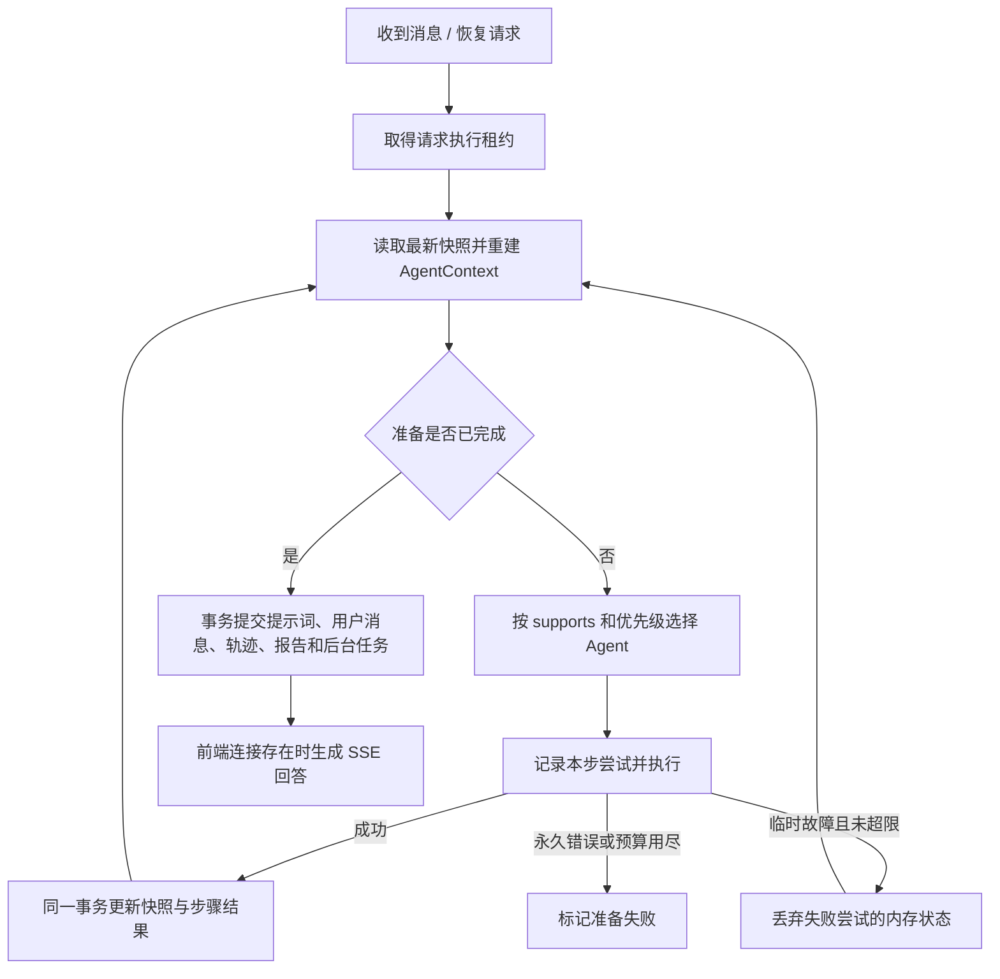

# Agent 准备阶段检查点与恢复

## 1. 一轮请求只保存一份最新快照

`AgentContext` 是本次执行使用的内存对象；`AgentContextSnapshot` 是它可序列化的数据副本。以 `requestId` 为主键在 `agent_checkpoints` 创建一条记录，每个 Agent 成功后更新这一条记录的 `snapshot_json` 和版本号，不反复插入完整上下文。同一个会话的不同消息有不同的 requestId，不能用 sessionId 作为快照主键。

保存内容包括：

| 模块 | 保存的结果与状态 |
| --- | --- |
| Memory | 历史消息、模型历史、memoryBrief、memoryLoaded |
| Supervisor | 意图与 intentRouted |
| Knowledge | 改写查询、知识片段原文/来源/分数、知识充分性、知识包版本、是否强制普通检索、knowledgeHandled |
| RiskGuardian | 评估结果、风险等级、riskAssessed |
| Companion/Counselor | 回复策略、完整回复提示词、responseAgent、responsePlanned、finished |
| 执行控制 | 已完成步数、当前步骤尝试次数、快照版本、截止时间、执行者标识 |

用户和会话实体通过已有请求记录恢复，不将 Hibernate 对象或服务连接序列化到 JSON。格式版本与工作流版本不兼容时停止恢复，提示重新提交。

另外，`agent_execution_steps` 保存少量诊断信息：Agent、步骤号、状态、尝试次数、耗时、观察摘要和错误类型。同一逻辑步骤的重试更新原记录，不保存每次重试的完整上下文。详细模型调用仍记录在原来的模型观测表中。完整上下文存储量是一份，但每步仍有数据库读写和 JSON 序列化成本。

## 2. 执行与恢复流程

例如 Memory、Supervisor、Knowledge 已完成，RiskGuardian 执行时进程中断：等待旧租约过期后，新执行者加载第三步的快照，直接从 RiskGuardian 开始。之前得到的历史和知识原文一起还原，无须重新检索。

如果 RiskGuardian 撤销知识包并要求重新检索，快照会保存 `forceNormalKnowledge=true` 和 `knowledgeHandled=false`。恢复后继续走 KnowledgeAgent，不能只按“这个 Agent 以前成功过”就跳过它。

失败尝试对内存 Context 的部分修改不会被保留。只有完整成功并提交的结果才构成恢复点。模型已完成但检查点未提交时，该步骤可能再次调用模型；本方案不宣称模型调用 exactly-once。

## 3. 并发、超时与副作用

- 复用请求行的 owner/lease，锁顺序统一为请求行→检查点行。快照提交还校验 revision、步骤和尝试次数；失去租约的旧执行者不能覆盖新结果。
- 数据库锁只用于短事务，不跨越模型调用。
- 每步默认超时 **30 秒**，临时故障每步最多 **3 次总尝试（含首次）**。重试等待默认为 500ms、1000ms。
- 全轮最多 **8 个成功步骤**，准备时间预算默认 **300 秒**，包含宕机等待时间。重启不会重置次数、步数和截止时间。
- 步骤运行租约为该步超时加 15 秒；首次领取、尚未开始步骤时租约为 180 秒。恢复扫描每 5 秒一次，应用启动后 10 秒开始；恢复不一定立即发生。
- 步骤线程池为 4 个线程、32 个排队位置；队列拒绝按暂时故障处理。线程中断是尽力取消，下游不响应取消时旧模型计算可能仍继续，但不能提交过期结果。
- 最终提示词、用户消息、完整轨迹、报告和工具任务仍在同一数据库事务提交。事务失败后可以从 READY 快照重做提交，不重复运行前面 Agent。
- 后台恢复只补齐准备结果及报告/任务，不生成无人接收的回答。浏览器重连后继续现有 SSE 恢复流程。
- 不兼容快照、损坏数据、永久错误或预算耗尽会结束请求，不把失败的风险评估当成低风险通过。升级前已中断、没有快照的老请求需要重新提交。

配置位于 `application.yml` 的 `mindharbor.agent`，可通过 `AGENT_PREPARATION_SECONDS`、`AGENT_STEP_TIMEOUT_MS`、`AGENT_RETRY_DELAY_MS` 和 `AGENT_RECOVERY_ENABLED` 调整。

## 4. 查看与验收

管理员界面新增“Agent 执行恢复”，接口 `GET /api/admin/agent-checkpoints` 返回最近 50 轮的状态、快照版本、完成步数及步骤尝试信息，不向接口暴露快照原文。学生访问该接口返回 403。

`AgentCheckpointAcceptanceTests` 覆盖以下 13 项：

1. RiskGuardian 中断后还原前三步结果，不重跑前三个 Agent。
2. 临时异常重试当前步骤，丢弃失败尝试的部分修改。
3. 永久错误停止执行，不生成回答或报告。
4. 步骤超时最多尝试三次，已完成步骤不重跑。
5. 已过期旧执行者的结果被拒绝。
6. 风险评估撤销知识包后再次执行 KnowledgeAgent。
7. 后台恢复准备结果，浏览器恢复时仅生成一次回答。
8. 六个并发恢复请求仅一个获得执行权。
9. 模拟重启后尝试预算不重置。
10. 恢复后仍受八步限制。
11. 最终提交事务回滚后，从 READY 继续且用户消息不重复。
12. 总期限耗尽或快照版本不兼容时停止恢复。
13. 每请求一条快照，管理接口隔离权限且不暴露原文。

以上为 H2 集成测试，通过保留数据库状态、废弃内存上下文和使租约过期模拟中断；不能等同于生产进程强杀或多实例压测。真实邮件投递不是这些测试的内容。

快照目前不自动清理；后续应结合聊天数据保留策略设置保留期限。它保留恢复所需的对话和知识内容，应采用与聊天数据相同的数据库访问控制及备份管理。

## 5. 本次验收记录（2026-10-23）

- 13 项新恢复测试和 97 项相关回归测试全部通过，共 **110 项，0 失败、0 错误**。回归覆盖原回复恢复、后台记忆、SSE、Agent 调度、风险规则、知识包和模型观测。
- 前端脚本通过 `node --check`，页面 HTTP 200，包含新的执行恢复面板；学生访问检查点管理接口实测 403。
- 已构建 `mindharbor-agent:local` 并更新原本机 `mindbridge-agent` 容器，健康检查 UP。保留原数据库和依赖容器。
- 实际发送一条考试焦虑/睡眠咨询，requestId 为 `bd0c207e-7a22-46fd-95db-cd9dafca4b09`：回复 SUCCESS、检查点 COMMITTED、5 个 Agent 均一次成功。
- MySQL 实查：**1 条快照、revision=5、completedSteps=5**；快照含 CONSULT 意图、LOW 风险、4 个知识片段、5 条最终提示词消息和 finished=true；另有 5 条精简步骤记录。
- 此次真实样本首 token 约 31.8 秒，总耗时约 33.4 秒。它验证恢复数据与正常链路，不构成提速结论。没有在真实部署强杀进程，故障恢复结论来自上文的可控集成测试。
- 数据库备份和真实验证记录位于本机忽略目录 `data/deploy/20261023-agent-checkpoints/`；旧镜像标签为 `mindharbor-agent:before-agent-checkpoints`。没有推送 GitHub。

本次为新增表，回退应用可将旧镜像重新标为 `mindharbor-agent:local` 并按原私有 Compose 重建 app；不要删除持久卷。新版本未完成的准备请求不应交给旧版恢复，应先完成或明确终止这些请求。数据库备份恢复是独立操作，会覆盖备份之后的数据，不作为普通镜像回退的默认步骤。
