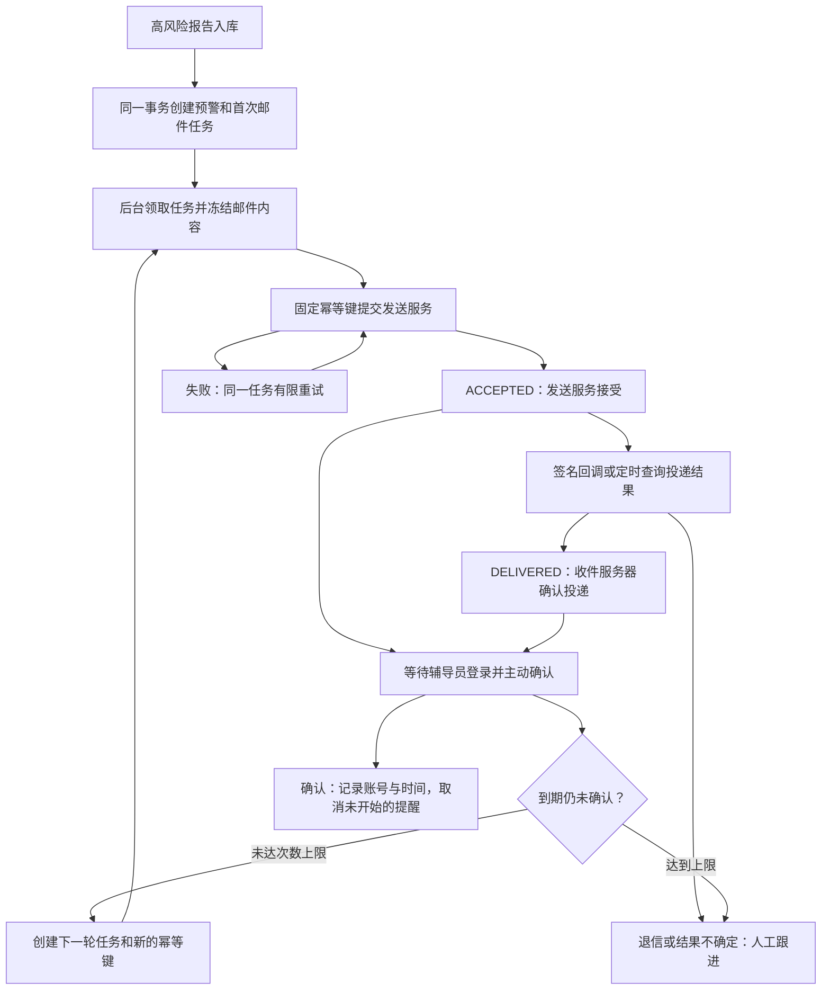
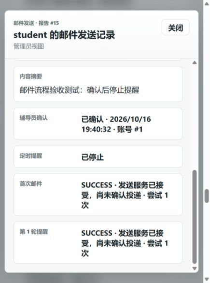

# 邮件发送去重、投递核对与辅导员确认

## 本次实现

### 一、三个状态分别表示什么

| 层次 | 数据 | 含义 |
|---|---|---|
| 执行状态 | `report_tasks.status` | PENDING/RUNNING/RETRYING/SUCCESS/FAILED/UNKNOWN/CANCELLED |
| 投递状态 | `report_tasks.delivery_status` | ACCEPTED/DELIVERED/DELAYED/BOUNCED/FAILED/COMPLAINED/SUPPRESSED/UNKNOWN/UNVERIFIED |
| 人员确认 | `alert_records.acknowledged_at/by` | 指定辅导员登录后点击确认的时间和账号 |

`SUCCESS` 只表示发送调用成功；`DELIVERED` 表示收件服务器接受，不保证进入收件箱或老师已阅读。打开邮件、点击链接、登录网站都不会自动确认。

### 二、发送去重

- 一份报告对每个收件人创建一份逻辑预警。
- 数据库唯一约束为 `(report_id, kind, recipient, reminder_round)`。首次发送 round=0，后续提醒为 1、2……。
- 每个任务生成并持久化随机 `idempotency_key`，同时冻结发件人、收件人、标题、正文和关联标签。失败重试复用同一键、同一内容；新一轮提醒获得新键。
- 发送前领取数据库租约，邮件网络请求在事务外执行；结果写回校验租约所有者。
- Resend 使用 `Idempotency-Key`。官方有效期为 24 小时，代码采用 23 小时的保守重放窗口，超出后转 UNKNOWN，禁止当作新邮件盲目重发。最多三次发送尝试。
- SMTP/MCP/HTTP 旧通道保留兼容。通用 SMTP 没有下游幂等保证；超时等不确定结果停止自动发送并提示人工核对。不能把自定义邮件头或数据库唯一键解释成 SMTP 端去重。
- 当前完整的“服务商去重+投递核对”实现通过 Resend HTTP 适配器完成。MCP 的既有工具接口保留；它没有自动获得第三方的投递查询能力。SMTP 本地演示可验证确认和提醒，显示 ACCEPTED；旧 log/http/mcp 通道只显示 UNVERIFIED。

### 三、投递结果确认

- `POST /api/mail/webhooks/resend` 接收 Resend 回调。
- 验证原始请求体的 Svix HMAC-SHA256 签名和五分钟时间窗，然后将事件持久化到 `mail_delivery_events`。以事件 ID 去重；持久化成功后才回复成功。
- 后台将事件关联到 provider email ID；若回调早于发送结果入库，可利用经过签名保护的 `mail_key` 标签恢复关联。未关联事件保留等待处理。
- 已知邮件 ID 的非终态邮件在一分钟后开始核对，后续每五分钟查询；最多 24 次，或者发送接受后超过 24 小时，转 UNKNOWN 并提示人工处理。
- 旧的 sent/delayed 事件不能把 DELIVERED 降级；退信、投诉等终态停止后续提醒。回调重复不会触发新的邮件。
- 发送无返回 ID 时优先在幂等有效期内重放原请求恢复 ID；仍无法确认则保留 UNKNOWN，等待签名回调或人工核对。

### 四、辅导员确认与定时提醒

- `ALERT_RECIPIENT_ACCOUNTS` 指定邮箱与已有账号的绑定，例如 `teacher@example.com=counselor1,other@example.com=counselor2`。
- 创建预警时把绑定账号 ID 固定存入预警。账号必须具备 ADMIN 或 COUNSELOR 角色；未配置绑定时不允许任意管理员代替老师确认。
- 管理员可查看全部状态；其他辅导员仅能查看自己的预警。确认操作只允许预警绑定账号。
- `GET /api/alerts/{id}` 查看状态；`POST /api/alerts/{id}/acknowledge` 确认。POST 还要求 `X-MindBridge-Action: acknowledge`，防止跨站表单借用 Basic 登录状态。
- 邮件链接 `/?alert={id}` 打开网站；登录后展示确认按钮。GET、打开链接和邮件打开事件均不确认。
- 默认首次发送成功后 600 秒仍未确认，创建第 1 轮提醒；第 1 轮成功后再等待 600 秒；最多追加 2 轮。达到上限后标记人工跟进。默认值用于项目演示，可按实际业务修改。
- 每轮最多三次技术重试，与“最多两轮业务提醒”是两个计数。
- 定时扫描、创建下一轮和确认都锁定同一预警；任务唯一约束补充防止重复创建。当前轮失败或结果不确定时，不能创建新轮绕过去重。
- 确认后取消 PENDING/RETRYING 任务；发送前再次检查确认状态。已经进入 SMTP/服务商网络调用的邮件无法撤回，极短的并发窗口可能多收到一封。
- 确认表示老师接收并准备跟进，不表示心理风险已经解除。人工升级记录仍保留审计。
- 迁移前的历史预警不自动开启提醒，避免升级后集中发送旧邮件；新预警使用新流程。

## 本地使用

运行中的页面：`http://localhost:8080/`。管理员演示账号 `admin / admin123`。

本地配置将 `counselor-alerts@example.com` 绑定到 admin，邮件发送到 Mailpit（`http://localhost:8025/`），不会真实投递到外部老师邮箱。

产生新的高风险报告后，在管理员“邮件记录”中打开详情，可看到首次发送、每轮提醒、投递状态和确认按钮。也可以点击 Mailpit 邮件中的预警链接。

## 启用真实服务商

在部署环境设置以下变量，不要把密钥提交到代码仓库：

| 变量 | 配置 |
|---|---|
| MAIL_PROVIDER | resend |
| RESEND_API_KEY | 有发送及读取邮件权限的服务商密钥 |
| RESEND_WEBHOOK_SECRET | 对应 webhook 的签名密钥 |
| ALERT_MAIL_FROM | 已验证域名的发件邮箱 |
| ALERT_MAIL_RECIPIENTS | 辅导员邮箱，多个用逗号分隔 |
| ALERT_RECIPIENT_ACCOUNTS | 邮箱=已有账号名称，多个用逗号分隔 |
| MINDBRIDGE_PUBLIC_URL | 可访问的 HTTPS 网站地址 |
| ALERT_REMINDER_SECONDS | 默认 600 |
| ALERT_MAX_REMINDERS | 默认 2 |

配置服务商 webhook 指向 `https://你的域名/api/mail/webhooks/resend`，订阅 sent、delivered、delivery_delayed、bounced、failed、complained、suppressed。

可在既有 Compose 文件后追加 `-f docker-compose.resend.yml`；此文件缺少必要配置时会直接拒绝启动，避免悄悄退回日志模式。不要在未完成任务期间随意换服务商账号；幂等键的作用范围属于原服务商账号。

当前交付没有创建服务商账号、配置公网域名或发送真实外部邮件。完整外部闭环需要以上部署配置，代码测试使用本地模拟服务商和 Mailpit。

## 数据兼容与主要文件

- Hibernate 增加字段和新的四列唯一索引；`MailSchemaMigration` 在确认新索引存在之后，仅移除旧的三列唯一索引。历史数据保留。生产环境建议把同样的 DDL 纳入正式迁移工具。
- `MailWorkflowService`：任务、提醒、确认、回调应用及核对。
- `MailGateway`：冻结消息、Resend 适配和旧通道兼容。
- `MailWebhookService`：验签和持久化事件收件箱。
- `MailWorkflowController`：状态、确认、回调接口。
- `static/app.js`：提醒轮次、投递与确认展示。

## 本次验收记录（2026-10-16）

- 137 项测试通过，其中新增 18 项覆盖邮件状态机、并发提醒、签名回调、回调先到、未知发送结果恢复、权限和服务商适配器；已有回复恢复测试继续通过。
- Docker 内 MySQL 自动升级成功：旧三列唯一索引被四列轮次唯一索引替换，历史记录保留。
- 本地新增一条明确标为系统验收的报告 #15 / 预警 #9；首次邮件和第 1 轮提醒均在 Mailpit 中可见。
- 验收时仅把该测试预警的到期时间提前，验证定时扫描；部署默认提醒间隔仍为 600 秒。
- 管理员点击确认后，`acknowledged_by=1`、确认时间落库，`next_reminder_at=NULL`。测试记录保留，便于在页面查看。
- 服务商 HTTP 适配与签名回调通过本地模拟验证，没有向真实外部收件人发送邮件。

## 服务商协议依据

- [Resend 幂等键](https://resend.com/docs/dashboard/emails/idempotency-keys)
- [投递事件定义](https://resend.com/docs/webhooks/emails/delivered)
- [查询邮件](https://resend.com/docs/api-reference/emails/retrieve-email)
- [签名验证](https://resend.com/docs/webhooks/verify-webhooks-requests)
- [Svix Java 验签规范](https://www.svix.com/guides/receiving/receive-webhooks-with-java/)
